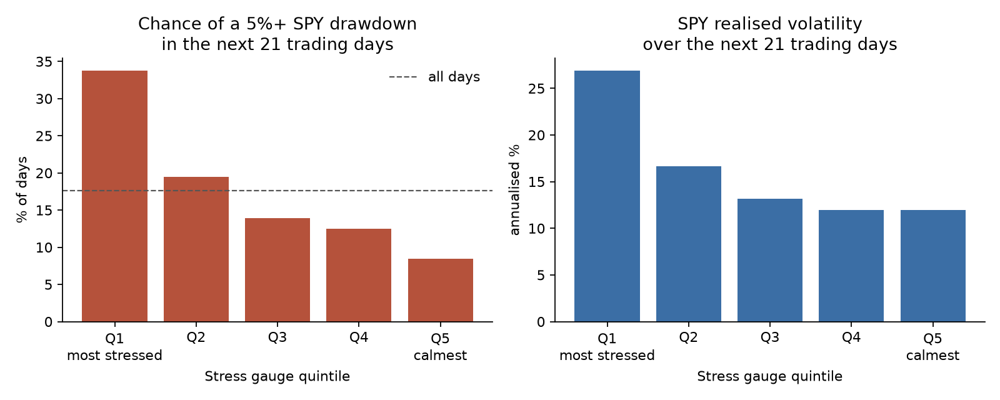

# vol-evidence

[](https://github.com/onisj/vol-evidence/actions/workflows/ci.yml)

**Testing the numbers options tools show traders.** Retail options tools display implied volatility from a data feed, market "stress" or "risk-on" scores, and AI news summaries. This project checks them against data, with the methods, results and caveats in the open (raw vendor data is regenerated locally by the scripts, not redistributed).

**Read the write-up: [ARTICLE.md](ARTICLE.md).** For a company-side study of the same stress-gauge question, see [Èrè Research](https://ere.markets/research/macro-gate-stress-score).

| Question | Answer | Study |
|---|---|---|
| Is the vendor's implied volatility consistent with the actual quote? | **Near the money, roughly; in the money, often not.** Across 15,522 contracts, vendor IV sat a median 1.1 vol points from the quote-implied IV out of the money, but 5.0 points in the money, where half were off by more than 5. Early exercise, wide quotes and stale last trades were each tested and ruled out as the main cause. | [IV audit](research/README.md#2-how-far-is-vendor-implied-volatility-from-the-quote-iv_auditpy-iv_americanpy) |
| Does a multi-input market stress gauge beat plain VIX? | **No.** A pre-registered four-input gauge sorted next-month drawdown risk from 33.7% to 8.4%, but added nothing beyond raw VIX (t = 0.21) and ranked volatility worse (−0.44 vs −0.66). | [Stress backtest](research/README.md#1-does-a-market-stress-gauge-beat-vix-stress_backtestpy) |
| Can next-month risk be forecast as a calibrated probability? | **Somewhat, and only with VIX.** A second pre-registered study (1990–2026, refitted yearly, 26 years out of sample) found that VIX beats the base rate, but every added input, including the variance risk premium and credit spreads, made forecasts worse. The models helped in calm years and in drawn-out bear markets, but before the sudden shocks of 2018 and 2020 all of them did worse than the base rate. | [Forecast study](research/README.md#4-can-next-month-risk-be-forecast-as-a-calibrated-probability-stress_v2py) |
| Does that hold in other markets? | **Partly.** Implied volatility forecast the volatility range well in all five markets tested, and the variance risk premium never helped. Drawdown probabilities worked for the S&P 500, Nasdaq-100 and gold but not for small caps. Under the pre-registered rule replication was not established, because two volatility series were unavailable. A public forward ledger now records forecasts before their outcomes. | [Replication](research/README.md#5-does-it-hold-in-other-markets-and-forward-in-time-stress_v3py-forecast_ledgerpy) |
| Can an LLM news digest be made checkable? | **Yes, by requiring citations.** In 132 digests from two models, every event cited real headline numbers, citation precision and recall were 96–99%, and no model followed a planted instruction to recommend a trade. Scores near the ceiling mean the probes were too easy; the judge came from the same model family as the models it graded. | [News evaluation](research/README.md#3-is-a-cited-llm-headline-digest-grounded-and-robust-news_evalpy) |



## Install

```bash
git clone https://github.com/onisj/vol-evidence.git
cd vol-evidence
python -m venv .venv && source .venv/bin/activate
pip install -e ".[research,llm,dev]"
```

## Use

```bash
vol-evidence iv SPY --max-dte 60     # vendor IV vs quote-implied IV, worst offenders listed
vol-evidence stress                  # today's stress gauge and its four inputs
vol-evidence news NVDA               # cited headline digest (needs ANTHROPIC_API_KEY or OPENAI_API_KEY)
```

Run `iv` during US market hours: outside them many quotes are one-sided or stale.

## What is inside

| Module | Purpose |
|---|---|
| `pricing.py` | Black-Scholes-Merton price and Greeks with a dividend yield, no-arbitrage bounds, an implied-volatility solver (Newton steps inside a bisection bracket), and an American-exercise binomial pricer with its own IV solver |
| `market_data.py` | yfinance chains and closes, the 13-week T-bill rate converted to continuous compounding, and dividend yields with the percent-vs-fraction trap handled |
| `iv_audit.py` | Solves IV from each two-sided quote and classifies quotes no European volatility can explain |
| `stress.py` | The pre-registered stress gauge, as pure functions shared by the live reading and the backtest |
| `riskforecast.py` | Features, targets, walk-forward refitting and scoring (Brier, pinball, reliability, coverage, block bootstrap) for the probability forecasts |
| `news.py` | Headline parsing for both yfinance news formats, and a cited digest with JSON-schema structured output |

## Engineering

```bash
pytest -q --cov=volevidence   # no network access needed
ruff check src tests research
mypy
```

- **Pricing** is checked against a textbook value, put-call parity with and without dividends, and finite-difference delta, gamma, vega, rho and theta. The IV solver is round-tripped across strikes and volatilities, and must refuse prices outside the no-arbitrage bounds.
- **Data traps** are pinned by tests: yfinance quotes `dividendYield` in percent but `trailingAnnualDividendYield` as a fraction, and moved news timestamps into a nested `content.pubDate` field.
- **LLM handling** is tested with a fake client: a thinking block before the text, refusals, truncation, and that the schema and instructions are sent.
- **Evaluation scoring** is tested on synthetic outputs before any paid run.

CI runs lint, type checks and tests on Python 3.10 and 3.12.

## Limitations

- **Data:** yfinance is unofficial and delayed.
- **Pricing model:** the main audit is European. US equity and ETF options are American, so a binomial re-solve checks how much that matters (very little here).
- **Backtest scope:** one market (SPY), one horizon, one period.

## Disclaimer

Research and education only, not investment advice. Nothing here recommends a trade.

## License

MIT. See [LICENSE](LICENSE).
