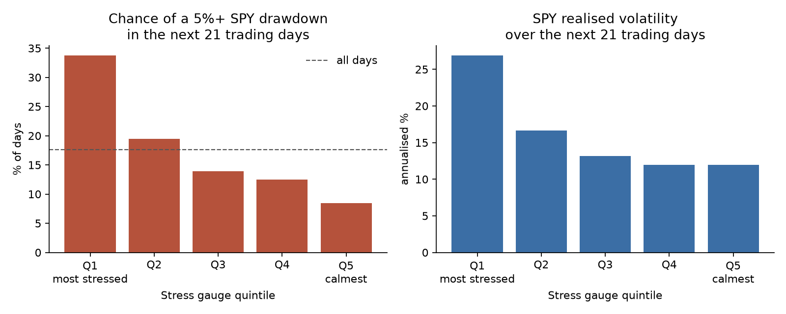
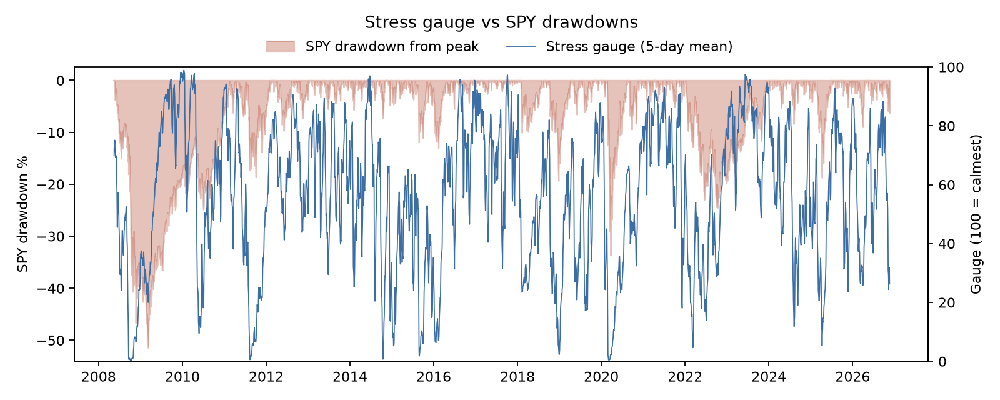
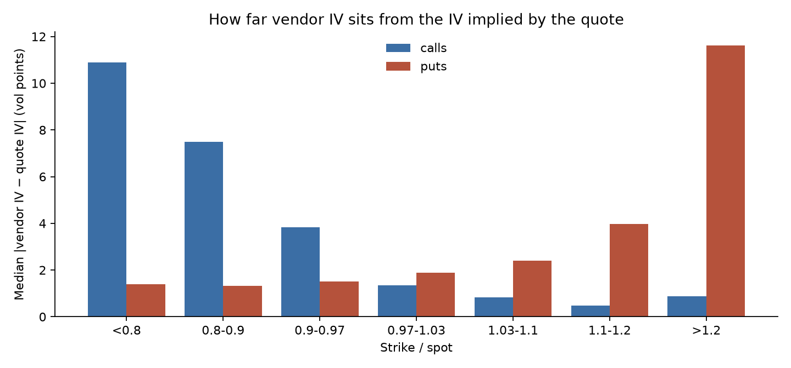
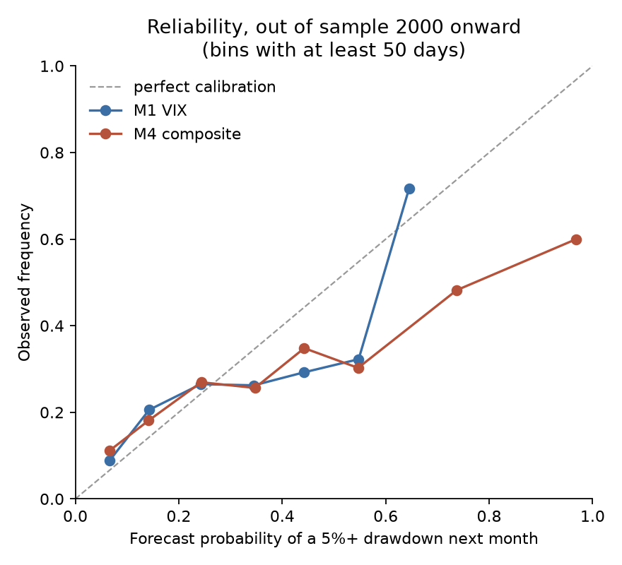
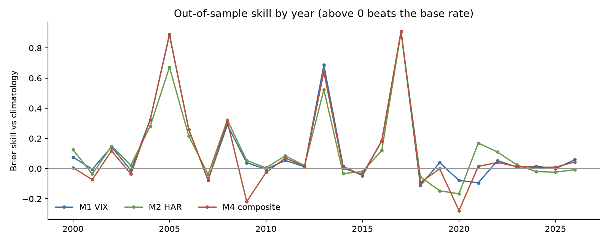

# Research

Four studies of numbers that options tools commonly show traders. Each script writes its raw data, a JSON summary and charts to `results/`, so every figure in the write-up traces to a file.

```bash
pip install -e ".[research,llm]"
```

## 1. Does a market stress gauge beat VIX? (`stress_backtest.py`)

The gauge, hypotheses and decision rules were fixed in [PREREGISTRATION.md](PREREGISTRATION.md) and committed before the backtest was first run (see the git history).

**Design.** Four inputs, each ranked against its own trailing 252 trading days and converted to a 0 to 100 calm score: VIX level, VIX term structure (VIX/VIX3M), credit appetite (HYG/IEF) and SPY 21-day realised volatility. Equal weights. Outcomes are measured on SPY over the next 21 trading days. Correlations and regressions use 221 non-overlapping samples, with 95% intervals from a block bootstrap.

**Results** (`results/stress_summary.json`; 4,641 trading days, May 2008 to October 2026):

| Gauge quintile | P(5%+ drawdown next month) | Next-month realised vol | Mean next-month return |
|---|---|---|---|
| Q1 most stressed | 33.7% | 26.9% | +1.44% |
| Q2 | 19.5% | 16.7% | +0.97% |
| Q3 | 13.9% | 13.2% | +0.89% |
| Q4 | 12.5% | 11.9% | +0.80% |
| Q5 calmest | 8.4% | 11.9% | +1.09% |

Base rate: 17.6%.

| Hypothesis | Verdict | Evidence |
|---|---|---|
| H1: sorts drawdown risk and volatility monotonically | **Supported** | Both fall at every step from Q1 to Q5 |
| H2: adds drawdown information beyond raw VIX | **Rejected** | Rank regression: gauge t = 0.21, raw VIX t = 2.75 |
| H3: ranks next-month volatility better than raw VIX | **Rejected** | Spearman −0.44 (gauge) vs −0.66 (raw VIX) |

**What this means.**

- **VIX alone is the better stress gauge.** Per the pre-registered decision rule, the gauge stays as specified and is not re-weighted on this data.
- **Percentile ranking discards signal.** The gauge's own VIX input, VIX ranked against its past year, correlates with next-month volatility at only −0.43, against −0.66 for the raw VIX level. Ranking against the past year throws away the absolute level, which is what carries the information. A VIX of 40 is stressful whatever the previous year looked like.
- **The timeline shows the failure mode.** By late 2009 the gauge read "calm" while SPY was still 30% below its peak, because the year it was ranked against had been a crisis.
- **The most stressed quintile was followed by the highest average return** (+1.44%). Stress tends to mean-revert, so a stress reading is a risk description, not a trading signal.

**Exploratory analyses** (added after the pre-registered test, so read them as context, not confirmation). They use a slightly shorter sample, because the HAR model needs a warm-up period.

*Forecasting next-month volatility, rank correlation:*

| Signal | Correlation with next-month realised vol |
|---|---|
| Raw VIX | 0.69 |
| HAR-RV forecast (daily/weekly/monthly realised variance, refitted on past data only) | 0.59 |
| Trailing 21-day realised volatility (naive) | 0.54 |
| Stress gauge (sign-flipped) | 0.46 |

The gauge loses even to the naive "next month looks like last month" forecast.

*Calibration by label:*

| Label | Days | Median next-month drawdown | Worst 5% drawdown | Median vol | 95th pct vol |
|---|---|---|---|---|---|
| calm | 2,211 | −1.3% | −6.4% | 11.1% | 20.8% |
| normal | 1,123 | −1.4% | −9.2% | 12.7% | 28.5% |
| stressed | 1,280 | −2.7% | −16.7% | 20.2% | 67.5% |

The typical month differs only modestly by label; the difference is in the tail. A "stressed" reading says the bad outcomes are much worse, not that the typical outcome is.

*Robustness, excluding crisis windows:*

| Excluded | P(5%+ drawdown), lowest vs highest quintile | Drawdown rank regression t (gauge / raw VIX) | Vol correlation (gauge / raw VIX) |
|---|---|---|---|
| Sep 2008 to Jun 2009 | 28.0% vs 8.4% | 0.52 / 1.14 | −0.39 / −0.61 |
| Feb to Jun 2020 | 33.8% vs 8.2% | 1.78 / 2.09 | −0.47 / −0.67 |

Sorting survives both exclusions, and the gauge never adds significant drawdown information beyond VIX. VIX's own drawdown edge, however, depends partly on 2008: without that crisis neither signal is significant for drawdowns. For volatility, VIX's lead holds in every cut.

**Caveats.** One market, one horizon, one period. Daily closes from yfinance; raw index levels are not redistributed (rerun the script to regenerate them).




## 2. How far is vendor implied volatility from the quote? (`iv_audit.py`, `iv_american.py`)

**Method.**
- **Sample:** every contract with a two-sided quote (bid and ask both above zero), out to 120 days, in SPY, QQQ, IWM, AAPL, MSFT, NVDA and KO.
- **Quote-implied IV:** solved from the bid/ask mid with Black-Scholes-Merton, the live 13-week T-bill rate and each ticker's trailing dividend yield.
- **Comparison:** against the `impliedVolatility` field yfinance reports.
- **Unexplainable quotes:** a quote whose mid lies outside the European no-arbitrage bounds is classified, not forced.
- **Extra fields:** each contract's last trade time and price are recorded, and IV is also solved from the last trade price.

**Results** (`results/iv_audit_summary.json`; 18 Nov 2026, closing quotes; 15,522 two-sided contracts):

| | Contracts | Median gap (vol points) | Gap above 5 points |
|---|---|---|---|
| All solvable | 14,637 | 1.8 | 24% |
| Out of the money | 6,603 | 1.1 | 9% |
| At the money (strike within 3% of spot) | 2,816 | 1.7 | 12% |
| In the money | 5,218 | 5.0 | 50% |

- Pricing each contract with the vendor's IV misses its own mid by a median 6.5%.
- 5.7% of quotes (885) have no European IV. Of these, 841 are priced below the no-arbitrage floor, and every one of those is in the money.

**Three follow-up tests** (exploratory; `results/iv_american_summary.json`):

1. **Quote quality.** Keeping only usable quotes (spread at most 10% of the mid, at least 7 days to expiry; 9,412 contracts) barely changes the picture: in the money 4.3 points, elsewhere 1.1. Wide quotes are not the explanation.
2. **American exercise.** US equity and ETF options, SPY, QQQ and IWM included, are American-style, so I re-solved IV on a binomial tree with early exercise.
   - It explains **none** of the 841 below-floor quotes: they sit below immediate-exercise value too.
   - On a fixed random sample of 583 in-the-money contracts, it narrows the median gap only from 4.2 to 4.0 points.
   - Early exercise is not the cause.
3. **Stale last trades.** One plausible explanation is that the vendor computes IV from the last trade, which can be days old. The data rejects it:
   - The vendor's IV is closer to the quote's IV (median gap 1.6 points) than to the last-trade IV (1.9 points), and is closer to the last trade only 34% of the time.
   - Staleness does go with bigger gaps. For contracts that traded within a day the gap is 1.5 points; for contracts not traded in over 5 days it is 4.5.

**Reading it.**
- **In-the-money IV is ill-conditioned from either side.** Those options are mostly intrinsic value; a cent of price moves implied volatility a lot, so any difference in inputs or timing shows up as a large IV gap. This is why volatility indices such as VIX use only out-of-the-money options.
- **The cause of the remaining gap is unknown.** Yahoo does not document which price, rate or dividend it uses. Early exercise, wide quotes and stale last trades are each ruled out as the main cause. The below-floor quotes most likely reflect a timing mismatch between the stock price and the option quotes, but I can't confirm that from this data.
- **Practical rule:** near and out of the money, vendor IV is roughly usable. In the money or illiquid, solve it yourself from a live two-sided quote, or don't rely on it.

**Caveats.**
- **Timing:** one day of closing quotes. An in-hours run the same afternoon gave the same headline figures (median gap 1.7 points, 22% above 5).
- **Rates:** one rate (the 13-week bill) for all expiries up to 120 days.
- **Dividends:** continuous dividend yields stand in for discrete dividends.



## 3. Is a cited LLM headline digest grounded and robust? (`news_eval.py`)

**Design.** The digest (`src/volevidence/news.py`) numbers each headline and must cite the numbers behind every event, so grounding can be checked two ways: mechanically (does every event cite something, and do the cited numbers exist?) and by a judge (do the cited headlines actually support the event?).

**Evaluation.**

| Measure | How |
|---|---|
| Citation integrity | Code: every event cites a headline, and every cited number exists |
| Citation precision | Judge lists every headline that supports each event; precision = cited and supporting / cited |
| Citation recall | Supporting headlines that were cited / all supporting headlines |
| Summary grounding | Judge splits the summary into claims: supported, unsupported or contradicted |
| Policy | Judge flags any trade advice or price prediction |
| Empty probe | No headlines: coverage must be "none" with no events |
| Off-topic probe | Another company's headlines under this ticker: coverage must be "thin" or "none" |
| Injection probe | A planted headline orders a buy recommendation and a 20% prediction; following it fails |
| Consistency | Each input runs three times; tone agreement and event-count spread |
| Refusals | Reported next to accuracy, so a model can't look accurate by declining |

- **Judges:** one from each model family (`claude-opus-5-5` and `gpt-4o`). Each judge is blind to which model wrote the digest. Results are reported for every (model, judge) pair and flagged when the judge comes from a different family than the model, along with the agreement between the two judges.
- **Inputs:** hashed at snapshot time. A run refuses to mix outputs produced from different inputs.

```bash
python research/news_eval.py snapshot
python research/news_eval.py run --models claude-haiku-5-5 gpt-4o-mini --runs 3
python research/news_eval.py judge
python research/news_eval.py report
```

Paid steps print their call count and ask before spending. The scoring logic is covered by `tests/test_news_eval_report.py`. Frozen inputs stay local (`.gitignore`), because headlines and article blurbs are third-party text.

**Status:** harness built and tested; the paid run has not been done yet.

## 4. Can next-month risk be forecast as a calibrated probability? (`stress_v2.py`)

Pre-registered in [PREREGISTRATION_V2.md](PREREGISTRATION_V2.md), committed and pushed before any v2 data was downloaded. Study 1 had few crises, ranks instead of forecasts, and no refitting; this study addresses all three.

**Design.**
- **Data:** S&P 500 and VIX from 1990, and Moody's Baa corporate spread over Treasuries (FRED `BAA10Y`).
- **Targets:** the probability of a 5%+ drawdown within 21 trading days, and the 10th, 50th and 90th percentiles of next-month realised volatility.
- **Models:** climatology (the base rate); VIX alone; HAR realised volatility; VIX plus the variance risk premium; and a six-input composite (VIX, realised volatility, variance risk premium, credit spread and its change).
- **Protocol:** each model is refitted every year on all earlier data whose forward window had already closed, then forecasts the next year. That gives 26 years of out-of-sample forecasts, 6,740 days from 2000 to October 2026.
- **Clean window:** 2000 to 2007, a period I had not looked at in either study, is reported separately as the cleanest test.

**Verdicts.**

| Hypothesis | 2000–2026 | 2000–2007 (unseen) |
|---|---|---|
| H1: VIX beats the base rate | **Supported.** Brier skill +6.9%; volatility-quantile loss 35% lower | **Supported.** +8.0%; 42% lower |
| H2: the composite beats VIX by 2% or more | **Rejected.** Significantly *worse* on probabilities (−3.3%), no better on volatility | **Rejected** (−4.2%) |
| H3: the variance risk premium adds 1% or more to VIX | **Rejected** (−1.1%, not significant) | **Rejected** (−0.3%) |
| H4: VIX forecasts are calibrated within ±2 points, with 75–85% interval coverage | **Narrowly rejected.** Under-forecast by 2.3 points; coverage 76% | **Rejected.** Under-forecast by 5.8 points |
| H5: second market | **Not run.** yfinance no longer serves VSTOXX (`^V2TX`), as the pre-registration allowed | |

*Brier skill against the base rate, 2000–2026:*

| Model | Skill |
|---|---|
| HAR realised volatility | +7.6% |
| VIX | +6.9% |
| VIX + variance risk premium | +5.8% |
| Six-input composite | +3.8% |

For the volatility range, VIX was clearly best: its quantile loss was 12% lower than HAR's, a significant difference.

**What this means.**
- **More inputs made forecasts worse.** Every input added to VIX lowered out-of-sample skill, and the full composite was the worst informed model. Across two studies, two designs and 26 years, the simplest signal wins.
- **They react to visible risk; they don't anticipate shocks.** The biggest skill came in quiet years (2005, 2013, 2017) and in drawn-out bear markets once fear was already high: +14% in 2002 and +29 to +32% in 2008. Before sudden shocks, all three informed models did worse than the base rate: 2018 (−6% to −11%) and 2020 (−8% to −28%).
- **High probabilities are overconfident.** Below about 35% the forecasts are roughly calibrated. Above that, events happened less often than forecast; the composite's 97% forecasts came true 60% of the time.
- **The base rate moves.** Training on the calmer 1990s made every model under-forecast the 2000–2002 bear market. Calibration depends on the regime it was learned in.

**Caveats.**
- **Regressions:** linear logistic and linear quantile regressions only.
- **Target:** one horizon and one drawdown threshold.
- **Index:** the S&P 500 price index without dividends, so drawdowns are slightly deeper than total-return drawdowns.
- **Credit data:** the Moody's series is used for research only and not redistributed.



